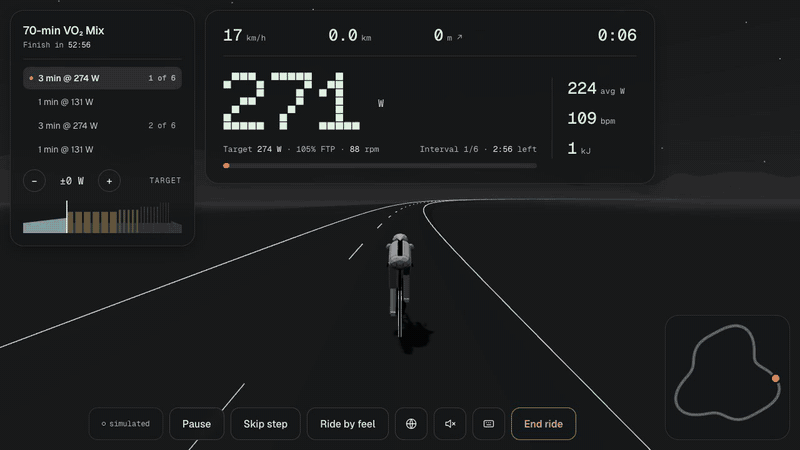

# Croissant Ride



An indoor trainer app that runs in the browser. Pair your smart trainer and heart-rate strap, pick a structured workout, and the trainer holds your target watts (ERG) while you ride a 3D loop. At the end you get a summary and a .FIT file to post to Intervals.icu, Strava, Garmin Connect or TrainingPeaks.

One rider, no accounts, no backend: everything stays in your browser.

**Try it:** [ride.arthurpfz.com](https://ride.arthurpfz.com) · **No trainer?** Pick any workout and choose demo mode, or open the [demo](https://ride.arthurpfz.com/?demo=1): a simulated trainer, heart rate and rider.

## Features

- **ERG workouts:** six built-in sessions in % of FTP, plus Free Ride. Import your own as Zwift-format `.zwo` files (what TrainingPeaks, Intervals.icu and others export), including coach notes.
- **Live data:** power (3 s average), heart rate, cadence, virtual speed and distance; target, time left in the step and the whole workout as a bar chart.
- **Rider controls:** target ±10 W, ride a step by feel (ERG off), skip, pause. Keyboard shortcuts; a Bluetooth presentation clicker or the original Zwift Click works as a handlebar remote.
- **Cues:** a 3-2-1 countdown, a beep and a spoken summary before each step change. ERG is released automatically when cadence drops too low (and comes back when you spin up).
- **Worlds:** three switchable looks (night sketch, space, valley), generated in code.
- **Recording:** 1 s samples, saved every 5 s so a crash or closed tab doesn't lose the ride; FIT export with laps per step and heart-rate variability (RR intervals).
- **Summary:** power against the targets, time in each zone, NP, TSS, average heart rate; "Post to" buttons that download the file and open the site's upload page.

## What you need

- **Browser:** Chrome or Edge on desktop or Android. They have Web Bluetooth; Safari, Firefox and every iPhone/iPad browser don't (on iOS, the Bluefy browser works).
- **Smart trainer:** one that speaks Bluetooth FTMS (most trainers from the last few years). Tested on a Van Rysel D100.
- **Optional:** a Bluetooth heart-rate strap, and a cadence sensor or power meter for cadence if your trainer doesn't report it.

## Run it locally

```bash
npm install
npm run dev
```

Then open `http://localhost:5173/?sim=1`. The simulator fakes a trainer, heart rate and a rider, so you can work on the app without hardware. Web Bluetooth works on `localhost`, so you can also pair a real trainer.

`npm run build` type-checks and builds the static site into `dist/`.

| URL flag | What it does |
|---|---|
| `?sim=1` | Simulated trainer, heart rate and rider |
| `?demo=1` | Same, as the visitor demo: ending the ride goes back to the normal start page |
| `?observe=1` | Read-only trainer: never takes control (e.g. beside another app) |
| `?debug=1` | Logs raw Bluetooth packets and trainer commands |

**Ride shortcuts:** `Space` pause · `+`/`-` (or Page Up/Down) target ±10 W · `E` ERG ⇄ ride by feel · `M` mute cues · `W` next world · `?` all shortcuts.

## Host your own

It's a static site: run `npm run build` and serve `dist/` from any static host (Netlify, Vercel, GitHub Pages, nginx). Web Bluetooth needs HTTPS (or `localhost`). There is nothing else to set up: no server, no database, no keys.

## Privacy

No accounts, no analytics, no uploads. Settings (FTP, weight) and the ride in progress live in your browser's local storage. Rides leave your computer only when you post the .FIT file yourself.

## Help wanted

- **More trainers:** Tacx FE-C over Bluetooth, Wahoo's older trainer protocol, trainers with only a resistance mode. A trainer is one driver file (see [CONTRIBUTING.md](CONTRIBUTING.md)).
- **Hilly routes:** a route with real climbs for Free Ride.
- **Testing on hardware:** reports from other trainers, heart-rate straps and cadence sensors.

## Contributing

See [CONTRIBUTING.md](CONTRIBUTING.md). [CLAUDE.md](CLAUDE.md) has a detailed map of the code.

## Licence

[Apache-2.0](LICENSE). Bundled third-party software, fonts and map data are listed in [public/THIRD-PARTY-NOTICES.txt](public/THIRD-PARTY-NOTICES.txt). The Col du Galibier contains IGN data (BD TOPO®, RGE ALTI®), Licence Ouverte 2.0.

Croissant Ride is an independent project, not affiliated with or endorsed by Zwift, Strava, Garmin, TrainingPeaks, Intervals.icu or any trainer maker. Their names are used only to say which file formats and services work with it.
